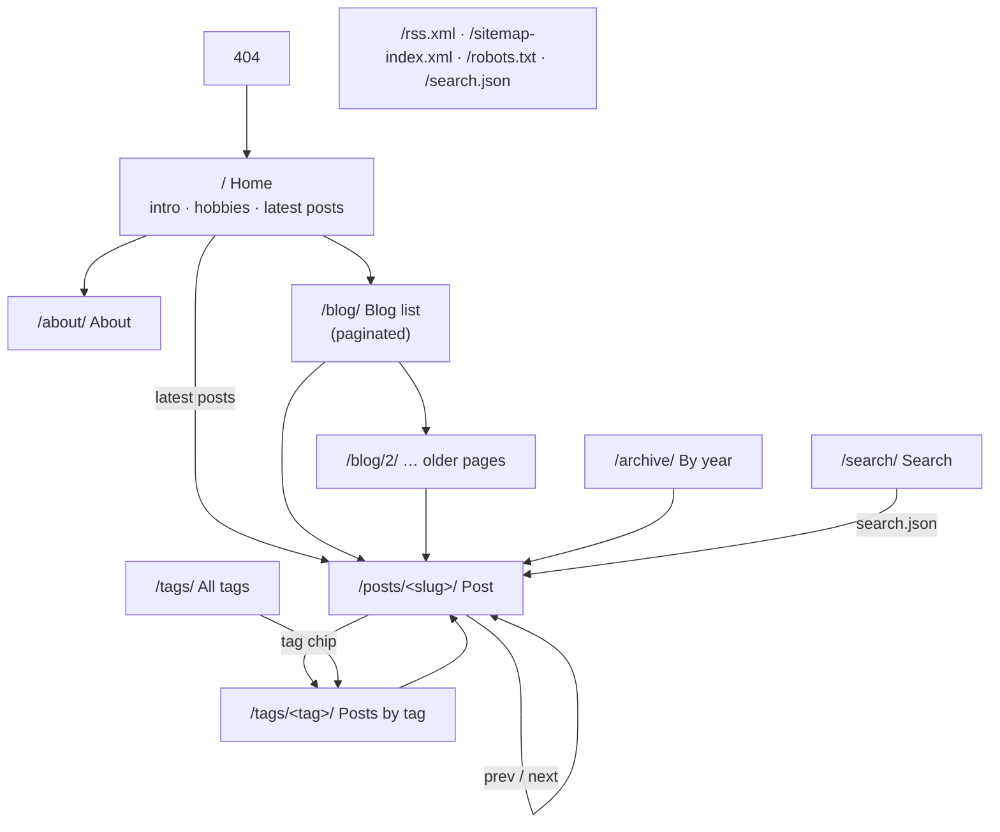

# Website Plan — Personal Blog

> Planning document for the personal website/blog in this repository.
> It describes **what** the site contains, **how** pages are organized, and **how** it looks.
| Item          | Value                                                              |
| ------------- | ------------------------------------------------------------------ |
| Site type     | Personal homepage + technical blog                                 |
| Audience      | Peers, recruiters, readers arriving from search / RSS              |
| Goals         | 1) Introduce the owner in seconds  2) Publish and archive writing  3) Look distinctive without hurting readability |
| Delivery      | Static site (Astro) served by Nginx                                |
| Languages     | English UI; posts may be English or Chinese (CJK fonts + reading time supported) |

---

## 1. Section and content planning

### 1.1 Sections at a glance

| # | Section            | Route                     | Purpose                                   | Content source                    | Status |
|---|--------------------|---------------------------|-------------------------------------------|-----------------------------------|--------|
| 1 | Home               | `/`                       | First impression: who I am, what I enjoy  | `src/data/profile.ts` + latest posts | Done |
| 2 | About              | `/about/`                 | Longer story, hobbies, (optional) links   | `src/data/profile.ts`             | Done |
| 3 | Blog               | `/blog/`, `/blog/2/` …    | Paginated list of all posts (8 per page)  | `src/content/posts/*.md(x)`       | Done (no posts yet) |
| 4 | Post               | `/posts/<slug>/`          | Read a single article                     | One Markdown file per post        | Done |
| 5 | Tags               | `/tags/`, `/tags/<tag>/`  | Browse by topic                           | `tags` in post frontmatter        | Done |
| 6 | Archive            | `/archive/`               | Every post grouped by year                | Posts                             | Done |
| 7 | Search             | `/search/`                | Find posts by title / tag / content       | Generated `/search.json`          | Done |
| 8 | 404                | any unknown URL           | Friendly dead-end with ways back          | Static                            | Done |
| 9 | Machine-readable   | `/rss.xml`, `/sitemap-index.xml`, `/robots.txt` | Feeds and SEO   | Generated at build                | Done |

### 1.2 Content per section

**Home (`/`)** — one screen that answers "who is this?"

| Block           | Content                                                        | Rules                                   |
| --------------- | -------------------------------------------------------------- | --------------------------------------- |
| Avatar          | Photo (`public/avatar.jpg`) or initials in a rotating gradient ring | Square image, ≥ 264 × 264 px      |
| Greeting + name | "Hello, I'm" + name in large gradient text                     | Name from `SITE.author`                 |
| Role line       | e.g. "DevOps Engineer · Builder · Lifelong Learner"             | ≤ 60 characters                         |
| Location        | Optional; hidden when empty                                    | Currently hidden                        |
| Intro card      | 2 short paragraphs                                             | 1–2 sentences each                      |
| Social buttons  | Optional; hidden when `SOCIAL_LINKS` is empty                  | Currently hidden                        |
| Hobby cards     | 6 cards: icon, title, one-line description                     | 3–9 cards; title ≤ 2 words; text ≤ 80 chars |
| Latest writing  | 5 newest posts + "All posts →"                                 | Shown only once posts exist             |

Current hobbies: Tinkering · Photography · Hiking · Reading · Music · Coffee.

**About (`/about/`)**

| Block      | Content                                         |
| ---------- | ----------------------------------------------- |
| Title      | "About me" + role line                          |
| Bio        | 2–4 paragraphs: work, interests, why this site exists |
| Hobbies    | Same list as Home, in compact list form         |
| Find me    | Optional links (hidden while empty)             |

**Blog / Tags / Archive / Search** — generated automatically from posts; each shows a friendly
"No posts yet" state until the first post is published.

**Post (`/posts/<slug>/`)**

| Block         | Content                                                        |
| ------------- | -------------------------------------------------------------- |
| Header        | Title, date, reading time, "Updated" date (optional), tags     |
| Cover         | Optional image, auto-converted to responsive WebP             |
| Contents      | Table of contents when the post has ≥ 3 H2/H3 headings         |
| Body          | Markdown: headings, lists, tables, quotes, images, code (with copy button) |
| Footer nav    | Previous / next post cards                                     |

### 1.3 Content plan for posts

Suggested initial categories (as tags) and a lightweight cadence:

| Tag          | Example topics                                          |
| ------------ | ------------------------------------------------------- |
| `devops`     | CI/CD pipelines, release strategies, incident notes     |
| `kubernetes` | Cluster setup, debugging pods, Helm tips                |
| `linux`      | Shell tricks, systemd, networking basics                |
| `nginx`      | Static hosting, caching, TLS (e.g. how this site is deployed) |
| `notes`      | Book notes, learning logs                               |
| `life`       | Photography, hiking trips, hobbies                      |

- Cadence: 1–2 posts per month; drafts (`draft: true`) are visible only locally.
- Every post needs `title`, `description` (one sentence, used in lists/RSS/search) and `pubDate`.
- Use 1–4 tags per post, lowercase, reuse existing tags where possible.

### 1.4 Global elements

| Element  | Content                                                                 |
| -------- | ----------------------------------------------------------------------- |
| Header   | Site title (→ Home) · Blog · Tags · Archive · About · Search icon · Theme toggle (sticky, frosted glass) |
| Footer   | © year + name (social links appear here if configured)                  |
| Meta     | Page title "Page · Site", description, canonical URL, Open Graph/Twitter tags |

---

## 2. Page structure diagrams

### 2.1 Sitemap



Plain-text version:

```
/  (Home)
├── /about/
├── /blog/ ─────────────┬── /blog/2/, /blog/3/ …
│                       └── /posts/<slug>/  ◄── prev/next ──►  /posts/<slug>/
├── /tags/ ── /tags/<tag>/ ── /posts/<slug>/
├── /archive/ ── /posts/<slug>/
├── /search/  (reads /search.json)
└── 404.html
Generated: /rss.xml  /sitemap-index.xml  /robots.txt  /search.json
```

### 2.2 Layout hierarchy

```
BaseLayout (every page)
├── <head>            BaseHead: meta/SEO, theme bootstrap (no flash)
├── DynamicBackground fixed, behind everything (aurora + particles + grain + vignette)
├── Header            sticky glass bar
├── <main>
│   ├── bare  → Home: content directly on the background (max 60rem)
│   └── panel → all other pages: frosted-glass panel (max 46rem)
│        └── PostLayout (posts only): header · cover · TOC · prose · prev/next
└── Footer            glass bar
```

### 2.3 Wireframe — Home (desktop)

```
┌──────────────────────────────────────────────────────────────────────┐
│ My Blog                         Blog  Tags  Archive  About   🔍  ☾   │  ← sticky glass header
├──────────────────────────────────────────────────────────────────────┤
│              · ·  ╲  animated aurora + particle background  ╱  · ·   │
│                              ╭──────╮                                │
│                              │  YN  │  ← avatar, rotating ring        │
│                              ╰──────╯                                │
│                            HELLO, I'M                                │
│                           Your  Name        ← gradient, 4.6rem        │
│              DevOps Engineer · Builder · Lifelong Learner            │
│           ┌────────────────────────────────────────────┐             │
│           │ Intro paragraph 1 …                        │ ← glass card │
│           │ Intro paragraph 2 …                        │             │
│           └────────────────────────────────────────────┘             │
│                                                                      │
│                          THINGS I ENJOY                              │
│     ┌──────────────┐   ┌──────────────┐   ┌──────────────┐           │
│     │ [icon]       │   │ [icon]       │   │ [icon]       │           │
│     │ Tinkering    │   │ Photography  │   │ Hiking       │  ← 3 cols │
│     │ one line …   │   │ one line …   │   │ one line …   │           │
│     └──────────────┘   └──────────────┘   └──────────────┘           │
│     ┌──────────────┐   ┌──────────────┐   ┌──────────────┐           │
│     │ Reading      │   │ Music        │   │ Coffee       │           │
│     └──────────────┘   └──────────────┘   └──────────────┘           │
│                                                                      │
│     LATEST WRITING                                 All posts →       │  ← only when posts exist
│     ┌────────────────────────────────────────────────────────┐       │
│     │ Post title · date · 3 min read · tags                  │       │
│     └────────────────────────────────────────────────────────┘       │
├──────────────────────────────────────────────────────────────────────┤
│ © 2026 Your Name                                                     │  ← glass footer
└──────────────────────────────────────────────────────────────────────┘
```

Mobile (< 640px): header wraps to two rows (title / nav), hobby grid becomes 1 column,
intro card padding shrinks, particle count is capped at 45.

### 2.4 Wireframe — Post page

```
┌──────────────────────────────────────────────────────────────┐
│ header                                                       │
├──────────────────────────────────────────────────────────────┤
│        ┌──────────────── glass panel (46rem) ───────────────┐ │
│        │ Post Title                                         │ │
│        │ Nov 16, 2026 · 4 min read · Updated …              │ │
│        │ [devops] [nginx]                                   │ │
│        │ ┌──────────── cover image (optional) ────────────┐ │ │
│        │ └────────────────────────────────────────────────┘ │ │
│        │ ▾ Contents  (≥ 3 headings)                         │ │
│        │   Section 1 / Section 1.1 / Section 2              │ │
│        │ Body text …                                        │ │
│        │ ┌ code block ───────────────────────────── [Copy] ┐ │ │
│        │ └─────────────────────────────────────────────────┘ │ │
│        │ ┌ ← Previous ─────────┐  ┌──────────── Next → ┐   │ │
│        │ └─────────────────────┘  └────────────────────┘   │ │
│        └─────────────────────────────────────────────────────┘ │
├──────────────────────────────────────────────────────────────┤
│ footer                                                       │
└──────────────────────────────────────────────────────────────┘
```

---

## 3. Style and color scheme

### 3.1 Design direction

- **Keywords:** calm, techy, airy, "night sky / aurora".
- **Signature element:** a living background — slow color glows plus a subtle particle
  constellation that reacts to the cursor. Everything else stays quiet so the background is the hero.
- **Readability first:** all text sits on frosted-glass surfaces (`backdrop-filter: blur`) or
  high-contrast type; motion never sits directly behind long-form text without a panel.
- **Two themes:** Light (pastel aurora) and Dark (deep-space aurora); follows the OS by default,
  user choice is remembered.

### 3.2 Color palette — UI tokens

Defined as CSS variables in `src/styles/global.css`.

| Token            | Role                          | Light                         | Dark                          |
| ---------------- | ----------------------------- | ----------------------------- | ----------------------------- |
| `--bg`           | Page base                     | `#F5F6FB`                     | `#070A16`                     |
| `--fg`           | Headings, primary text        | `#161A2B`                     | `#EEF0FB`                     |
| `--fg-soft`      | Body text                     | `#343A52`                     | `#C9CDE3`                     |
| `--muted`        | Meta text, labels             | `#5F6680`                     | `#9097B5`                     |
| `--accent`       | Links, active states, focus   | `#4F46E5` (indigo)            | `#A5B4FC` (light indigo)      |
| `--accent-2`     | Gradient end (name, headings) | `#C026D3` (fuchsia)           | `#F0ABFC` (light fuchsia)     |
| `--accent-soft`  | Tag chips, hover backgrounds  | indigo @ 10 %                 | light indigo @ 14 %           |
| `--surface`      | Glass panels, header, footer  | white @ 62 %                  | `#0E1224` @ 58 %              |
| `--surface-border` | Glass edge highlight        | white @ 75 %                  | white @ 9 %                   |
| `--border`       | Dividers, table lines         | `#161A2B` @ 10 %              | white @ 10 %                  |

**Brand gradient** (avatar ring, hobby icons):
`#6366F1` indigo → `#A855F7` purple → `#EC4899` pink (→ `#22D3EE` cyan in the ring).

### 3.3 Color palette — animated background

Defined in `PALETTES` in `src/components/DynamicBackground.astro`.

| Layer        | Light theme                                                   | Dark theme                                                   |
| ------------ | ------------------------------------------------------------- | ------------------------------------------------------------ |
| Base         | `#F5F6FB`                                                     | `#070A16`                                                    |
| Aurora glows | `#A5B4FC` `#F0ABFC` `#67E8F9` `#FDA4AF` `#93C5FD` (55 %, normal blend) | `#4F46E5` `#9333EA` `#0891B2` `#DB2777` `#2563EB` (50 %, screen blend) |
| Particles    | indigo `rgb(79,70,229)`, lines 16 %                            | pale blue `rgb(205,215,255)`, lines 22 %                      |
| Grain        | 3.5 % opacity                                                 | 6 % opacity                                                  |
| Vignette     | soft white edges                                              | near-black edges                                             |

### 3.4 Typography

| Use              | Font stack                                                     | Size / weight                  |
| ---------------- | -------------------------------------------------------------- | ------------------------------ |
| UI + body        | System sans (`system-ui`, Segoe UI, Roboto, PingFang SC, Microsoft YaHei, Noto Sans CJK) — no web-font download | 17px, line-height 1.7 |
| Home name        | Same, gradient fill                                            | `clamp(2.6rem, 9vw, 4.6rem)`, 800 |
| Page title       | Same                                                           | 2rem, 700                      |
| Section labels   | Uppercase, letter-spacing 0.16em                               | 0.85rem, 700, muted color      |
| Code             | `ui-monospace`, SF Mono, JetBrains Mono, Menlo, Consolas       | 0.88rem                        |

### 3.5 Layout, shape and spacing

| Property            | Value                                         |
| ------------------- | --------------------------------------------- |
| Reading width       | 46rem (panel pages)                           |
| Wide width          | 60rem (home, header, footer)                  |
| Side gutter         | 1.25rem (no horizontal scroll at 360px)       |
| Radius              | 20px panels · 10px code/images · 12px icons · pill (999px) tags/buttons |
| Glass effect        | `blur(18px) saturate(160%)` + 1px light border + soft shadow |
| Breakpoints         | 640px (panel padding, hero), 560px (prev/next stack), 520px (header) |

### 3.6 Motion

| Element          | Behavior                                         | Duration      |
| ---------------- | ------------------------------------------------ | ------------- |
| Aurora glows     | Slow Lissajous drift, gentle size "breathing"    | continuous, ~60 fps |
| Particles        | Drift, link when < 130px apart, pushed by cursor | continuous    |
| Hero             | Staggered fade-up on load                        | 0.8s, 90ms steps |
| Name             | Gradient shimmer                                 | 8s alternate  |
| Avatar ring      | Rotation                                         | 8s linear     |
| Hobby cards      | Fade-in on scroll; lift + cursor spotlight on hover | 0.6s / 0.25s |
| Theme switch     | Background palette swaps instantly               | —             |
